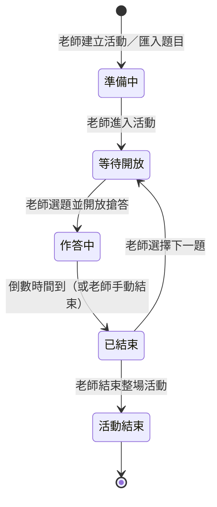
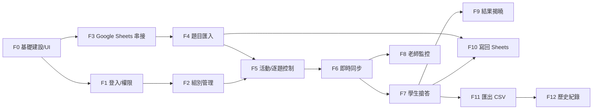

# 課程搶答系統 Roadmap

> 本文件依據系統需求描述，將系統拆分為可獨立規格化（`/speckit-specify`）、規劃與實作的功能模組，
> 並排定開發階段與相依關係。所有功能皆須遵守 [`.specify/memory/constitution.md`](.specify/memory/constitution.md)
> 的五項原則（輸入驗證、清楚錯誤訊息、機敏資料只放環境變數、正常／邊界案例測試、回報測試指令與結果）。

---

## 1. 系統概觀

| 角色 | 主要能力 |
|------|----------|
| **老師** | 登入、從 Google Sheets 匯入學習單題目、選擇並開放搶答題目、即時監控作答、結束搶答、將答案寫回 Google Sheets、匯出活動結果 CSV |
| **學生** | 登入、加入組別、等待題目開放、以組別為單位送出答案、搶答結束後檢視所有組別答案與自己組別是否搶答成功 |

**核心規則**

1. 搶答採**逐題進行**：同一時間只有一題處於「開放作答」。
2. 學生以**組別**為單位送出答案；**最快送出**的組別為搶答成功（純以伺服器收到時間判定，系統**不持有正確答案**、不判斷對錯）。
3. 每題搶答以**老師設定的時間**倒數，時間到自動結束；老師也可**手動提前結束**。
4. 搶答結束前，學生**看不到**其他組別的作答；結束後所有組別的答案統一呈現。
5. 所有使用者的**活動階段必須即時同步**（最重要的需求）。
6. 學習單以 **Google Sheets** 線上讀寫，不下載成 `.xlsx` 離線處理；匯入／匯出必須**依表單格式動態解析欄位**，不得寫死儲存格位置；寫回時**只寫入搶答成功的唯一組別答案**。
7. 帳號由**系統自動建立**，以**學號＋預設密碼**登入。
8. UI 為 **RWD**（手機／平板／電腦），統一**米白色系**，按鈕使用**撞色**。

### 活動階段狀態機（全系統同步的核心）

| 階段 | 老師畫面 | 學生畫面 |
|------|----------|----------|
| 等待開放 | 題目清單，可選題開放 | 「等待老師開放題目」 |
| 作答中 | 即時監控：剩餘時間、哪些組別已送出、送出順序、手動結束按鈕 | 題目＋作答區＋剩餘時間（僅見自己組別狀態） |
| 已結束 | 全部組別答案、搶答順位 | 全部組別答案＋「本組搶答成功／未成功」 |
| 活動結束 | 匯出 CSV、寫回 Google Sheets | 活動結束提示 |

---

## 2. 功能模組拆分

每個模組對應一份未來的 `specs/<編號>-<名稱>/spec.md`。優先級：**P0** = MVP 必要、**P1** = 需求明定但可於 MVP 後完成、**P2** = 加分／強化。

### F0. 專案基礎建設與 UI 風格系統 — P0

- 前後端專案骨架、lint／測試框架、CI 執行測試指令。
- 環境變數載入與啟動檢查（缺少必要變數時明確報錯並停止），提供 `.env.template`。
- 統一錯誤回應格式（例如 `{ error: { field, message, hint } }`）。
- **設計系統**：米白色系底色（例：`#FAF7F0`／`#F5F0E6`）、撞色按鈕（例：深藍 `#1F3A93`、珊瑚橘 `#FF6B4A`），以 CSS 變數／design tokens 統一定義。
- **RWD**：mobile-first 版面、斷點（手機 < 640px、平板 640–1024px、桌機 > 1024px），按鈕觸控區 ≥ 44px。
- **驗收**：所有頁面共用同一套 tokens；在 375px 與 1440px 寬度下無水平捲動、功能可完整操作。

### F1. 登入與身分驗證／權限控管 — P0

- **帳號由系統自動建立**：老師匯入學生名單（學號、姓名，可含組別）後，系統批次建立學生帳號，帳號＝學號、密碼＝預設密碼。
- 預設密碼為**全體學生統一的一組值**，由環境變數 `STUDENT_DEFAULT_PASSWORD` 提供，**不得寫死在原始碼或文件**；密碼以雜湊（如 bcrypt）儲存。
- 建議：首次登入強制修改預設密碼（待確認是否需要）；老師可重設學生密碼回預設值。
- 老師帳號由系統初始化（seed／管理指令）建立，初始密碼來自環境變數。
- 登入介面：輸入學號／帳號與密碼，登入後依角色導向老師頁或學生頁。
- 角色權限（RBAC）：只有老師能進入題組匯入匯出、開放題目、監控作答、匯出結果；學生只能使用搶答頁。
- 後端 API 全面驗證 token／session 與角色，不只靠前端隱藏按鈕。
- 登出、session 逾時處理。
- **輸入驗證**：學號格式（長度、字元）、密碼必填；名單匯入時檢查學號重複與缺漏並指出是哪一列；登入失敗訊息不洩漏「帳號是否存在」。
- **測試**：批次建立帳號、名單含重複學號、以學號＋預設密碼登入成功（老師／學生）、錯誤密碼、空欄位、學生呼叫老師 API 回 403。

### F2. 組別管理 — P0

- 學生被指派到組別（隨 F1 名單匯入一併指定，或由老師在系統中調整，待確認）。
- 老師可檢視各組成員。
- 規則：一位學生同一活動只屬於一個組別。
- **測試**：加入組別成功、重複加入、加入不存在的組別。

### F3. Google Sheets 串接層 — P0

- 透過 Google Sheets API 直接讀寫雲端試算表（不下載 `.xlsx`）。
- 認證方式：Service Account（老師將學習單分享給服務帳號）或 OAuth（老師以自己的 Google 帳號授權），待確認。
- 憑證（金鑰 JSON、client secret）**只放環境變數**。
- 封裝 `readSheet(spreadsheetId, range)`、`writeCells(spreadsheetId, updates[])` 等介面，供 F4、F10 使用。
- 錯誤處理：試算表 URL／ID 格式錯誤、無存取權限、配額超限、網路錯誤，皆回傳清楚訊息。
- **測試**：以 mock 驗證讀寫；無權限與錯誤 ID 的邊界案例。

### F4. 學習單題目匯入（動態解析）— P0

- 老師輸入 Google Sheets 連結 → 系統讀取並**依表單格式動態辨識**題號、題目、（選項）以及每題的**作答欄位**（待填寫答案的空白儲存格）。
- 系統**不匯入正確答案**，也不判斷對錯。
- 解析策略：以標題／關鍵字（如「題號」「題目」「Q1」「答」）定位欄位與每題的作答儲存格，**不得寫死儲存格**（例如不可寫死第一題答案在 `C19`）。
- 解析時記錄每題「答案應寫回的儲存格位置」（供 F10 使用）。
- 匯入前預覽：老師確認解析結果後才寫入系統；可重新匯入覆蓋。
- **輸入驗證**：連結格式、工作表存在、至少一題、題號不重複、必要欄位缺漏時指出是哪一列／哪一欄。
- **測試**：標準格式學習單、欄位順序不同的學習單、空白表單、缺少題目欄位、合併儲存格等版面變化。

### F5. 活動管理與逐題開放控制（老師）— P0

- 建立／開始活動（綁定已匯入的題組與組別）。
- 老師從題目清單**選擇要開放搶答的題目**，一次只能開放一題。
- **作答時間**：每題在老師按下「開始搶答」時設定作答秒數，**預設 60 秒**（老師可修改），時間到由**伺服器計時**自動結束；老師可隨時**手動提前結束**。
- 操作：開放搶答（含設定時間）、手動結束搶答、切換下一題、結束整場活動。
- 狀態轉換由後端狀態機把關（例如不可在「作答中」再開另一題；時間到與手動結束同時發生時只結束一次）。
- **輸入驗證**：作答秒數必須為正整數且在合理範圍（例如 5–600 秒，待確認）。
- **測試**：正常流程開→時間到自動結束→下一題；手動提前結束；秒數為 0／負數／非數字；非法狀態轉換被拒絕並回傳清楚錯誤。

### F6. 即時同步機制 — P0（最重要）

- 以 WebSocket（或 Socket.IO／SSE，待 plan 決定）推播活動階段變化給所有在線使用者。
- 倒數計時以伺服器的結束時間點為準（推播 `endsAt`），前端只負責顯示，避免各裝置時鐘不同造成剩餘時間不一致。
- **伺服器為唯一真實來源**（server-authoritative）：階段、目前題目、送出順序皆以伺服器狀態為準。
- 斷線重連／重新整理頁面後，能自動取回目前活動階段並回到正確畫面。
- 依角色與階段過濾推播內容：「作答中」階段**不得**將其他組別答案推送給學生（後端過濾，不靠前端隱藏）。
- **驗收**：老師切換階段後，所有學生畫面在 1 秒內（目標值，待確認）同步；重連後狀態正確。
- **測試**：多客戶端同步、斷線重連、晚加入者取得正確狀態、學生端收不到他組答案。

### F7. 學生搶答作答 — P0

- 「作答中」時顯示題目與作答區；「等待開放」時顯示等待畫面。
- 以**組別為單位送出答案**；同組任一成員送出即代表該組（或指定組長送出，待確認），同組其他成員即時看到「本組已送出」。
- 每組每題只能送出一次（是否允許修改，待確認）。
- **搶答順位**由伺服器依收到時間決定（伺服器時間戳＋原子操作，避免同時送出時的競態條件）；**最快的組別為搶答成功**，與答案內容無關（系統不判斷對錯）。
- 時間到或老師手動結束後（「已結束」）拒絕送出並回傳清楚訊息；結束瞬間抵達的送出以伺服器狀態為準。
- 若時間內無任何組別送出，該題無搶答成功組別。
- **輸入驗證**：答案非空、長度上限、題目 ID 必須為目前開放的題目、使用者必須屬於某組別。
- **測試**：正常送出、重複送出、時間到後送出、手動結束後送出、空答案、超長答案、多組同時送出的順位正確性、無人送出。

### F8. 老師即時監控看板 — P0

- 「作答中」即時顯示：各組是否已送出、送出順序與時間、目前最快組別。
- 「已結束」顯示所有組別答案與搶答順位。
- 顯示在線人數／各組在線狀態（P2）。

### F9. 搶答結果揭曉（學生）— P0

- 搶答結束後，學生畫面統一呈現**所有組別**的答案（依順位排列）。
- 明確標示**本組是否搶答成功**（最快送出者）。
- 結束前完全看不到他組作答（由 F6 後端過濾保證）。
- **測試**：結束前 API／推播不含他組資料；結束後資料完整且成功標示正確。

### F10. 答案寫回 Google Sheets（動態對應欄位）— P1

- 每題**只寫入搶答成功的唯一組別**的答案，**依 F4 解析出的作答欄位位置**寫回學習單對應儲存格；其他組別答案不寫回（保留在 CSV）。
- 無搶答成功組別的題目保持空白、不寫入。
- 不得寫死儲存格；表單格式改變時，重新匯入即可得到新的對應位置。
- 寫入前檢查目標儲存格是否已有內容並提示覆蓋確認。
- **測試**：以 mock 驗證只寫入成功組別、寫入位置與 F4 解析結果一致；不同格式學習單；無人搶答的題目；無寫入權限。

### F11. 活動結果匯出 CSV — P1

- 搶答結束後老師可匯出活動結果 CSV，欄位至少包含：**題號、組別、答案、搶答順位**（可加：送出時間、是否搶答成功）。
- 使用 UTF-8 with BOM 以確保 Excel 開啟中文不亂碼。
- 正確跳脫逗號、換行、引號；防範 CSV 公式注入（以 `= + - @` 開頭的內容加前綴處理）。
- **測試**：一般資料、含逗號／換行／中文的答案、無任何作答紀錄時的匯出。

### F12. 活動結果保存與歷史紀錄 — P2

- 將每場活動結果保存於資料庫，老師可回顧過往活動並重新匯出。

---

## 3. 相依關係

---

## 4. 開發階段（Milestones）

| 階段 | 內容 | 完成標準（Demo 情境） |
|------|------|------------------------|
| **M1 基礎與登入** | F0、F1、F2 | 老師匯入名單後系統自動建立學生帳號；學生以學號＋預設密碼登入並被導向搶答頁、老師導向管理頁；學生已分組；手機與電腦版面皆正常、米白＋撞色風格一致 |
| **M2 題目匯入** | F3、F4 | 老師貼上 Google Sheets 連結，系統動態解析出題目並預覽、匯入；換一份欄位順序不同的學習單也能正確解析 |
| **M3 搶答核心（MVP）** | F5、F6、F7、F8、F9 | 老師開放一題並設定 60 秒 → 多位學生（不同組）同時作答 → 老師即時看到送出順序 → 時間到（或老師手動結束）後學生看到所有組答案與本組是否成功；過程中重新整理頁面仍回到正確階段 |
| **M4 匯出** | F10、F11 | 各題搶答成功組別的答案依表單格式寫回原 Google Sheets 對應欄位；老師下載含題號、組別答案、搶答順位的 CSV |
| **M5 強化** | F12、效能與壓力測試、UI 打磨 | 全班規模（例如 50 人、10 組）同時搶答時同步穩定；可查詢歷史活動 |

建議每個功能依憲章流程推進：`/speckit-specify` → `/speckit-clarify` → `/speckit-plan` → `/speckit-tasks` → `/speckit-implement`，並在完成時回報測試指令與結果。

---

## 5. 環境變數（預計）

| 變數 | 用途 | 所屬模組 |
|------|------|----------|
| `SESSION_SECRET`／`JWT_SECRET` | 簽署登入 token／session | F1 |
| `STUDENT_DEFAULT_PASSWORD` | 自動建立學生帳號時的預設密碼 | F1 |
| `TEACHER_INITIAL_PASSWORD` | 初始化老師帳號的密碼 | F1 |
| `DATABASE_URL` | 資料庫連線 | F0 |
| `GOOGLE_SERVICE_ACCOUNT_KEY` 或 `GOOGLE_CLIENT_ID`／`GOOGLE_CLIENT_SECRET` | Google Sheets API 認證 | F3 |
| `APP_BASE_URL` | OAuth 回呼與 CORS 設定 | F1、F3 |

實際值只放 `.env`（列入 `.gitignore`），repo 只提供不含實際值的 `.env.template`。

---

## 6. 已確認決策

| 項目 | 決策 |
|------|------|
| 登入方式 | 系統自動建立帳號，學生以**學號＋預設密碼**登入 |
| 預設密碼 | 全體學生**統一一組預設密碼**，值由 `STUDENT_DEFAULT_PASSWORD` 設定（依憲章原則 III，實際值不寫入 repo） |
| 搶答成功判定 | **只以時間為準**，最快送出的組別成功；系統不接收正確答案、不判斷對錯 |
| 搶答結束條件 | 依**老師設定的作答時間**自動結束，老師可**手動提前結束** |
| 作答時間 | 老師每次**開始搶答時設定**，**預設 60 秒** |
| 寫回 Google Sheets | 每題**只寫入搶答成功的唯一組別**答案 |

## 7. 待釐清事項（建議於 `/speckit-clarify` 階段確認）

1. **帳號建立來源**：學生名單如何提供（上傳 CSV、從 Google Sheets 讀取，或手動輸入）？由於全體共用同一組預設密碼，首次登入是否強制改密碼？
2. **組別**：組別隨名單一起指定，還是老師在系統中分組？每組人數上限？
3. **組別送出規則**：同組任何人都能送出，還是只有組長能送出？送出後可否修改？
4. **作答時間上下限**：老師可設定的秒數範圍（例如 5–600 秒）？
5. **Google 認證方式**：Service Account（需老師分享試算表）或 OAuth（老師自行授權）？
6. **學習單格式範例**：需取得 1–2 份實際學習單樣本，以定義動態解析規則與測試資料。
7. **同步延遲目標與規模**：預期同時在線人數與可接受的同步延遲。
8. **題型**：僅簡答文字，或也包含選擇題、圖片題？
